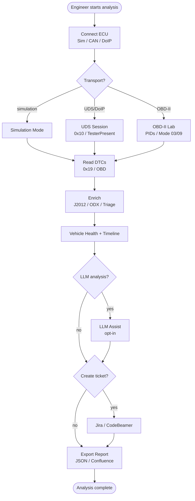
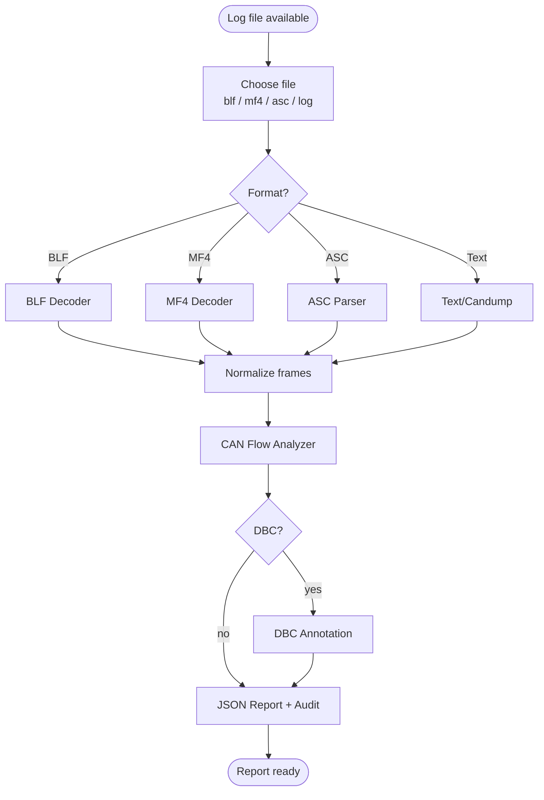
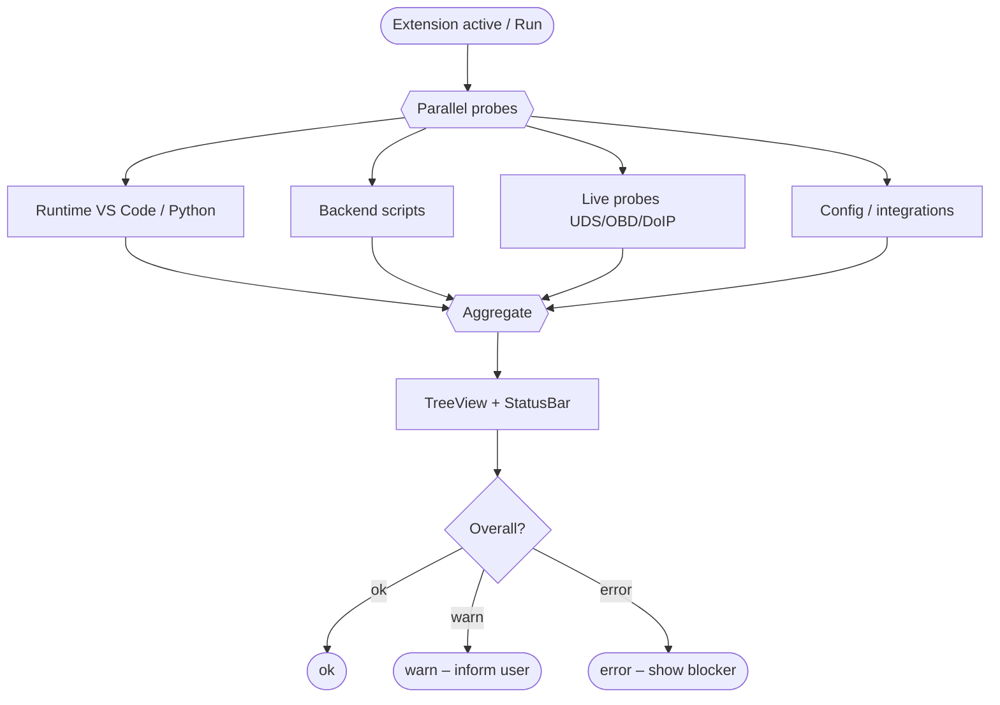
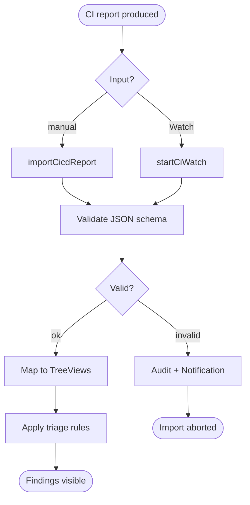

# UML Activity diagrams

Same four processes as [BPMN](BPMN), in **UML Activity** form (PlantUML + Mermaid).

Repository: [`docs/uml/`](https://github.com/horizons237-admin/vehicle-debugging-assistant/tree/main/docs/uml)

| Process | PlantUML | Mermaid |
|---------|----------|---------|
| Diagnostic analysis | [`.puml`](https://github.com/horizons237-admin/vehicle-debugging-assistant/blob/main/docs/uml/01_diagnostic_analysis.puml) | [`.mmd`](https://github.com/horizons237-admin/vehicle-debugging-assistant/blob/main/docs/uml/01_diagnostic_analysis.mmd) |
| Bus-log pipeline | [`.puml`](https://github.com/horizons237-admin/vehicle-debugging-assistant/blob/main/docs/uml/02_buslog_pipeline.puml) | [`.mmd`](https://github.com/horizons237-admin/vehicle-debugging-assistant/blob/main/docs/uml/02_buslog_pipeline.mmd) |
| Self diagnostic | [`.puml`](https://github.com/horizons237-admin/vehicle-debugging-assistant/blob/main/docs/uml/03_self_diagnostic.puml) | [`.mmd`](https://github.com/horizons237-admin/vehicle-debugging-assistant/blob/main/docs/uml/03_self_diagnostic.mmd) |
| CI/CD import | [`.puml`](https://github.com/horizons237-admin/vehicle-debugging-assistant/blob/main/docs/uml/04_cicd_import.puml) | [`.mmd`](https://github.com/horizons237-admin/vehicle-debugging-assistant/blob/main/docs/uml/04_cicd_import.mmd) |

---

## 1. Diagnostic analysis

---

## 2. Bus-log pipeline

---

## 3. Self diagnostic

---

## 4. CI/CD report import

---

## Viewing PlantUML

1. Open [plantuml.com/plantuml](https://www.plantuml.com/plantuml/uml/)
2. Paste contents of a `.puml` file from the repo
3. Or use the VS Code **PlantUML** extension

See also: [BPMN](BPMN) · [Process diagrams overview](Process-Diagrams)
